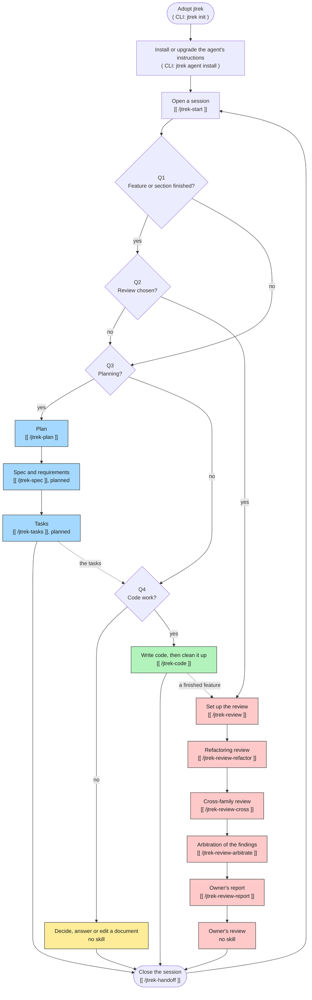

# Overall map — the whole of jtrek, conceptually

> {{SHARED:generated-banner}}

This document draws jtrek's workflow as a whole, from the moment a project adopts jtrek to the review of a finished feature. It is a conceptual map, written for people. It shows only the nodes that do work and the questions that decide which work is done, and it leaves out sessions, tests, gates and the loops between them. Two detailed maps draw those: [`{{MAP_WORK_DOC}}`]({{MAP_WORK_DOC}}) for code and other work, and [`{{MAP_REVIEW_DOC}}`]({{MAP_REVIEW_DOC}}) for the review. Planning has no detailed map yet, because the way planning is divided into stages is still being decided. Until it has one, [`{{PLANNING_DOC}}`]({{PLANNING_DOC}}) is the procedure that the blue nodes follow. An agent follows the procedures that the detailed maps name, and does not act on any map's summary of them. Terms such as **feature**, **plan section** and **requirement** are defined in [`{{GLOSSARY_DOC}}`]({{GLOSSARY_DOC}}).

---

## The flowchart

The colour of a node says which detailed map draws it. Blue is planning, yellow is work other than code, green is code, and red is the review. A diamond is a question, and a rounded box is where the workflow begins or where a session ends.

The second line of a node, where there is one, says how the node is started. `[[ /name ]]` names the skill whose procedure the node follows, and `( CLI: command )` names the jtrek command that the node runs. Skills exist only in Claude Code, so in another agent a skill's name stands for the procedure document of the same name. A node marked **planned** names a skill that does not exist yet, and its work is done today by the node before it.

A solid arrow is the path a session takes. A dotted arrow carries no session. It shows the order in which work moves from one kind to the next: planning produces the tasks, which Q4 sorts into code and other work, and a finished feature is what the review reads.

---

## The questions

All four questions are asked about the work the owner chose when the session opened, in Step 5 of [`{{OPENING_DOC}}`]({{OPENING_DOC}}).

- **Q1 — Is a feature or a plan section finished?** The owner answers it, and only the owner can, because nothing in the store records that a feature or a plan section is finished.
- **Q2 — Did the owner choose its review?** The owner answers it, by choosing the review's task or one of its stages' tasks in `/jtrek-start`, or by asking for the review to be set up. If the review was not chosen, the session takes other work instead, and sorting that work begins with Q3.
- **Q3 — Is it planning?** The session answers it from the record the owner chose. A planning task is one whose prose file names `/jtrek-plan`. The owner may also start planning directly, by running `/jtrek-plan`.
- **Q4 — Is it code work?** The session answers it from the record the owner chose. Code work implements a feature, fixes a bug or changes what the product does, and it follows [`{{CODING_DOC}}`]({{CODING_DOC}}). Any other work, such as a decision, an answer to a question or a change to a document, follows the rules alone.
