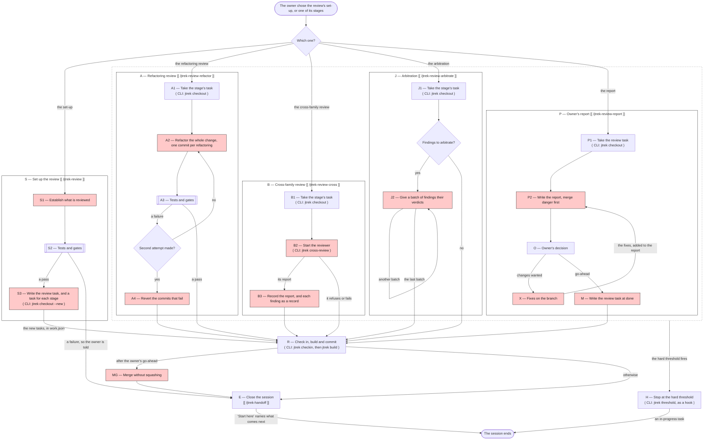

# Review map — the review of a finished feature or plan section

> {{SHARED:generated-banner}}

This document draws the review of a finished feature or plan section, which is red in [`{{MAP_OVERALL_DOC}}`]({{MAP_OVERALL_DOC}}). The review has a set-up and four stages, and each of them runs in a session of its own. The set-up starts in a new session once the session that wrote the code has closed. The map begins once the owner has chosen the set-up or a stage, and it ends when that session ends. It is written for people. An agent follows the procedure that each card names, and does not act on the map's summary of it. Terms such as **feature**, **feature branch** and **requirement** are defined in [`{{GLOSSARY_DOC}}`]({{GLOSSARY_DOC}}).

The map has three parts. The flowchart shows the nodes and what passes between them. Below it, a card for each node says what starts the node, what it may change, what it does, what it reads and what it produces. The table at the end says which principles each node applies or checks.

**Keep the three parts in step.** No command compares them. When a node is added, removed or renamed, change the flowchart, its card and its column of the table in the same commit, and change the procedure the card names. When the overall map changes a node that this map draws, change this map too. When a document a node reads is renamed or replaced, search this file for its path.

---

## The flowchart

Every node named with a letter has a card below. A rectangle with double sides is a run of the tests and the gates, and a plain rectangle is any other node. A diamond is a question, and a rounded box is where the map begins or ends. The label on an arrow is what passes along it. A red node does the review's own work, and a white node is a step that sessions of every kind take, such as taking a task or checking it in.

The second line of a node, where there is one, says how the node is started. `[[ /name ]]` names the skill whose procedure the node follows, and `( CLI: command )` names the jtrek command that the node runs. A command marked as a hook is run by the agent's harness rather than by the session. Skills and hooks exist only in Claude Code, so in another agent a skill's name stands for the procedure document that the node's card names, and the node a hook starts is started by the session watching its own size.

Each box with a title is one session, which follows the procedure its title names. No arrow leads from one box to another, because each stage starts in a new session. Two things carry the order instead. Each stage's task names the task of the stage before it under `depends_on`, and the hand-off's "Start here" names the next stage when a session closes. The dashed box holds the four stages, and the hard threshold can fire in any of them.

---

## The questions

- **Which one?** The owner answers it, either by invoking the skill of the set-up or of a stage, or by choosing a task in [`{{OPENING_DOC}}`]({{OPENING_DOC}}) whose prose file names the procedure to follow. Every stage runs unless the owner skips it, as the section "Which stages run" of [`{{REVIEWING_DOC}}`]({{REVIEWING_DOC}}) says. Skipping the cross-family review also skips the arbitration, and the owner's report always runs. A stage the owner skipped has no task, so it is never offered.
- **Second attempt made?** The refactoring review's session answers it, as Step 3 of [`{{REVIEW_REFACTOR_DOC}}`]({{REVIEW_REFACTOR_DOC}}) says. The writer's code passed before the refactoring began, so a failure now was caused by a refactoring commit. The session gets one attempt to fix or revert the commits that caused it, and no more.
- **Findings to arbitrate?** The arbitration's session answers it from the section "Cross-family review" in the review task's prose file, which lists the finding records. There are none when the cross-family review was abandoned, did not run, or found nothing.

---

## The nodes

### S1 — Establish what is reviewed

- **Started by:** The owner starts this node by starting a new session for the set-up, once the owner has said that a feature or a plan section is finished and the session that wrote the code has closed. In Claude Code the session runs `/jtrek-review`, whose argument names what is reviewed and the stages to skip. [`{{REVIEWING_DOC}}`]({{REVIEWING_DOC}}) is its procedure.
- **May change:** It creates a branch named `review/<slug>` from the main branch when a plan section is reviewed.
- **Does:** For a feature, it works on the branch `feature/<slug>`. The change is everything the branch added since it left the main branch, which `git diff main...HEAD` shows, and the requirements are those whose `feature` is the feature's slug. For a plan section, all of its features have merged already, so there is no single branch to diff. The change is then the current state of every file that the section's feature branches changed, which the session finds from the commits that merged them. The requirements are those whose `plan` names the section. Step 1 of the procedure gives the commands.
- **Reads:** It reads [`{{REVIEWING_DOC}}`]({{REVIEWING_DOC}}) and the requirements. For a plan section, it also reads the section's purpose and its "done when" in [`{{PLAN_DOC}}`]({{PLAN_DOC}}).
- **Produces:** It produces the change and the requirements that the stages will review.

### S2 — Tests and gates

- **Started by:** The set-up's session starts this node once it knows what is reviewed, as the checklist at the end of Step 1 of [`{{REVIEWING_DOC}}`]({{REVIEWING_DOC}}) says.
- **May change:** It changes nothing.
- **Does:** It runs the whole test suite and the three gates that [`{{RULES_DOC}}`]({{RULES_DOC}}) lists, because a review of code that does not yet work reviews the wrong thing. It also checks that `{{STORE}}/coding-standards.md` exists, unless the refactoring review is skipped, because that stage has nothing to refactor against without it. When a test or a gate fails, the session records each failure as a `bug` record, because rule R4 in [`{{RULES_DOC}}`]({{RULES_DOC}}) gives every finding a row, and it does not fix the failure. The fix is the feature's own work, made on the branch through [`{{MAP_WORK_DOC}}`]({{MAP_WORK_DOC}}), whose writer fixes the code rather than the test, and the set-up runs again once the fix is in. When either check fails, the session opens no review task, tells the owner what failed, and closes.
- **Reads:** It reads the code, the tests and the store.
- **Produces:** It produces a pass, or a `bug` record for each failure and a list of the failures for the owner.

### S3 — Write the review task, and a task for each stage

- **Started by:** The set-up's session starts this node when the tests and the gates pass, in Step 2 of [`{{REVIEWING_DOC}}`]({{REVIEWING_DOC}}).
- **May change:** It writes `{{STORE}}/work.json` and the new tasks' prose files.
- **Does:** It runs `jtrek checkout --new` and writes the review task, titled "Review of feature `<slug>`" or "Review of plan section `<slug>`". The review task's prose file states what is reviewed, the range of commits, the stages the owner skipped, and the skill and procedure that run the report. It then writes one task for each stage that runs, apart from the report. Each stage task's prose file names the skill and the procedure that run the stage. Each stage task names the review task under `related_to`, and the stage task before it under `depends_on`. The review task names every stage task under `depends_on`, because the report is written from what the stages found.
- **Reads:** It reads [`{{REVIEWING_DOC}}`]({{REVIEWING_DOC}}) and [`{{SCHEMA_DOC}}`]({{SCHEMA_DOC}}).
- **Produces:** It produces the open review task and an open task for each stage that runs, in `work.json`.

### A1, B1, J1 and P1 — Take the task

- **Started by:** The owner starts each of these nodes by starting a new session for the stage. The session either runs the stage's skill directly or opens with [`{{OPENING_DOC}}`]({{OPENING_DOC}}) and chooses the stage's task. "Before starting" in each stage's procedure is the procedure for this node.
- **May change:** It writes `{{STORE}}/work.json`.
- **Does:** It checks that the session is fresh, which means that its conversation holds nothing from before the stage's procedure was invoked apart from opening the session. The refactoring review and the arbitration need a session that has not seen the code being written. It checks that the stage before has finished, which means that the task named under `depends_on` is `done` or `abandoned`. The report checks every stage task the review task names. It then finds the task with `jtrek query` and takes it with `jtrek checkout --id`, unless the opening procedure already took it. If there is no task, the owner skipped the stage or the review was never set up. If the task is `in-progress`, an earlier session stopped at the hard threshold, and this one continues from the task's note and prose file. The refactoring review also checks that `{{STORE}}/coding-standards.md` exists. When any check fails, the session stops before changing anything and tells the owner why.
- **Reads:** It reads its own conversation, the store, and the review task's prose file, which states the change.
- **Produces:** It produces an open checkout of the stage's task, or of the review task for the report.

### A2 — Refactor the whole change, one commit per refactoring

- **Started by:** The refactoring review's session starts this node once it holds the task, in Step 1 of [`{{REVIEW_REFACTOR_DOC}}`]({{REVIEW_REFACTOR_DOC}}). It starts it again for the second attempt, when node A3 finds a failure.
- **May change:** It changes the code and commits. In the store, it may write a record for a defect it finds.
- **Does:** It refactors the whole change until the code meets the coding standards, and it runs the whole test suite before starting and after each refactoring. It adds no behaviour and weakens no test, though it may make a test that checks nothing check something. It commits each refactoring separately, with a message that begins "Refactoring review:" and names the standard it meets, so that a stop loses at most the refactoring in hand. A defect that cannot be fixed without changing behaviour gets a record of its own and is left unfixed. On the second attempt, it fixes or reverts the commits that caused the failure.
- **Reads:** It reads `{{STORE}}/coding-standards.md`, the change, and the whole of each changed file where a line cannot be judged without its surroundings.
- **Produces:** It produces one commit per refactoring, and any genuine questions for the owner.

### A3 — Tests and gates

- **Started by:** The refactoring review's session starts this node when the refactoring is finished, in Step 2 of [`{{REVIEW_REFACTOR_DOC}}`]({{REVIEW_REFACTOR_DOC}}), and again after the second attempt.
- **May change:** It changes nothing.
- **Does:** It runs the whole test suite and the three gates over the refactored code, because the refactored code is what the later stages and the owner read.
- **Reads:** It reads the code, the tests and the store.
- **Produces:** It produces a pass, or a list of the failures and the commits that caused them.

### A4 — Revert the commits that fail

- **Started by:** The refactoring review's session starts this node when the tests or the gates still fail after the second attempt, in Step 3 of [`{{REVIEW_REFACTOR_DOC}}`]({{REVIEW_REFACTOR_DOC}}).
- **May change:** It commits reverts.
- **Does:** It reverts only the commits that fail, and keeps the ones that pass. The reverted commits stay in the branch's history. The owner decides in node O whether the revert stands, or whether the refactoring is redone as a fix in node X.
- **Reads:** It reads the failures and the commits that caused them.
- **Produces:** It produces revert commits, and the names of the reverted commits and their failures for node R to record.

### B2 — Start the reviewer

- **Started by:** The cross-family review's session starts this node once it holds the task, in Step 1 of [`{{REVIEW_CROSS_DOC}}`]({{REVIEW_CROSS_DOC}}).
- **May change:** It changes nothing. The reviewer makes no edit, no commit and no record.
- **Does:** It runs `jtrek cross-review --feature <slug>`, or `--section <slug>` for a plan section. The command reads the `cross_review` block of `jtrek.json`, refuses a reviewer from the writer's family of models, and starts the named agent read-only and without interaction. It gives the agent Part B of [`{{REVIEWING_DOC}}`]({{REVIEWING_DOC}}), the requirements and the change, leaving out the store's own files. The agent reads the change against the requirements and the architecture document and reports what is wrong. When the command refuses or fails, the cross-family review has not run, and no reviewer from the writer's family takes its place. The owner may then run Part B by hand in another lab's agent.
- **Reads:** The reviewer reads Part B, the requirements, the parts of [`{{ARCHITECTURE_DOC}}`]({{ARCHITECTURE_DOC}}) that name the feature or section, and the change. For a plan section, it also reads the section's purpose and its "done when" in [`{{PLAN_DOC}}`]({{PLAN_DOC}}).
- **Produces:** It produces the reviewer's findings, most serious first, or a statement that it found none together with a list of what it read. When the command refuses or fails, it produces the reason instead.

### B3 — Record the report, and each finding as a record

- **Started by:** The cross-family review's session starts this node when the reviewer reports, in Step 2 of [`{{REVIEW_CROSS_DOC}}`]({{REVIEW_CROSS_DOC}}).
- **May change:** It writes records into the stage's checkout, and the stage task's prose file.
- **Does:** It first appends the reviewer's whole report to the stage task's prose file, so that the report survives a stop before every finding is recorded. It then writes each finding as a `bug` or `change` record, with the review task under `related_to`. It records every finding, including one the session believes is wrong, and each record's prose file holds the reviewer's claim in the reviewer's own words.
- **Reads:** It reads the reviewer's report and rule R4 in [`{{RULES_DOC}}`]({{RULES_DOC}}).
- **Produces:** It produces one record per finding.

### J2 — Give a batch of findings their verdicts

- **Started by:** The arbitration's session starts this node when there are findings to arbitrate, in Step 2 of [`{{REVIEW_ARBITRATE_DOC}}`]({{REVIEW_ARBITRATE_DOC}}), and again for each batch.
- **May change:** It adds a revision to each finding's record and writes the stage task's prose file. It changes no code and no test, though it may run the tests.
- **Does:** It adds a few findings at a time to the checkout with `jtrek checkout --add --id`, in the reviewer's order. It checks each finding against the code and gives it one verdict. Confirmed means that the code shows what the finding says, disputed means that evidence shows the finding is wrong, and uncertain means neither. It disputes a finding only with evidence the owner can check, such as a passing test, the lines of code concerned or the requirement the finding misread. A finding it doubts only by reasoning stays uncertain. It removes no finding and leaves the reviewer's wording as it is, and its verdicts advise the owner and settle nothing. It writes each batch's verdicts into their records before starting the next batch, so that a stop loses at most the batch in hand.
- **Reads:** It reads the reviewer's report, what the reviewer read, and the code and tests each finding names.
- **Produces:** It produces a verdict and its evidence in each finding's record.

### P2 — Write the report, merge danger first

- **Started by:** The report's session starts this node once it holds the review task, in Step 1 of [`{{REVIEW_REPORT_DOC}}`]({{REVIEW_REPORT_DOC}}), and again after the owner's fixes.
- **May change:** It writes the review task's prose file.
- **Does:** It writes the report from the sections the stages appended, rather than from memory, in this order. First come the merge danger and every stage that did not run, with whether the owner skipped it or it failed to run, and why. Then come a short summary, pseudo code and Mermaid diagrams of what changed, and the commits, with the refactoring review's listed apart from the writer's. Last come the findings with their verdicts, where the disputed findings form a group of their own with the reviewer's claim beside the arbitrator's evidence. After fixes, it adds which findings were fixed and lists the commits of the fixes apart, with their merge danger first.
- **Reads:** It reads the sections the stages appended to the review task's prose file, the change, the commits, the finding records, the section "The merge danger" of [`{{REVIEWING_DOC}}`]({{REVIEWING_DOC}}), and the project's own one-way doors in [`{{ARCHITECTURE_DOC}}`]({{ARCHITECTURE_DOC}}).
- **Produces:** It produces the report.

### O — Owner's decision

- **Started by:** The report's session starts this node by putting the report in front of the owner, in Step 2 of [`{{REVIEW_REPORT_DOC}}`]({{REVIEW_REPORT_DOC}}).
- **May change:** Only the owner decides here.
- **Does:** The owner reads the report, closely wherever it names a one-way door, and then gives the go-ahead or asks for changes. A two-way door with a small blast radius may be read lightly.
- **Reads:** The owner reads the report.
- **Produces:** It produces the go-ahead, or a list of changes.

### X — Fixes on the branch

- **Started by:** The owner starts this node by asking for changes in node O.
- **May change:** It changes the code and the records on the branch.
- **Does:** The report's session makes each change through the loop that [`{{MAP_WORK_DOC}}`]({{MAP_WORK_DOC}}) draws, from writing the change to checking it in, with the tests and the gates run before each check-in. No stage runs again unless the owner asks for it, because the owner asked for the fixes and reads them in the report. The review task stays open.
- **Reads:** It reads what the work map's nodes read, and the findings the owner chose.
- **Produces:** It produces commits and revisions of the finding records, which node P2 adds to the report.

### M — Write the review task at done

- **Started by:** The report's session starts this node on the owner's go-ahead, in Step 2 of [`{{REVIEW_REPORT_DOC}}`]({{REVIEW_REPORT_DOC}}).
- **May change:** It writes `{{STORE}}/work.json`.
- **Does:** It adds a revision of the review task at `done`, whose `note` records the owner's approval.
- **Reads:** It reads the review task.
- **Produces:** It produces the closed review task, in `work.json`.

### R — Check in, build and commit

- **Started by:** The session starts this node when the work of its box is finished. The step is the last step of each procedure but the report's, and Step 2 of [`{{REVIEW_REPORT_DOC}}`]({{REVIEW_REPORT_DOC}}) for the report.
- **May change:** It writes the review task's prose file, appends rows to `{{STORE}}/registry.ndjson`, regenerates `{{STORE}}/registry.md`, and commits on the branch.
- **Does:** For the set-up, it checks in the new tasks. For a stage, it first appends a dated section to the review task's prose file, headed with the stage's name: "Refactoring review", "Cross-family review" or "Arbitration". The refactoring review's section lists the commits and names each reverted commit with its failure. The cross-family section says whether the review ran and why not if it did not, names the agent and the model, lists the finding records, and names any feature the reviewer was not shown. The arbitration's section names the model and lists each finding with its verdict, the disputed findings as a group. If the report has already been written, the stage adds what it did to the report too. The session then adds a revision of the stage's task at `done`, whose `note` gives the stage's figures. For the report, it checks in the review task written in node M. In every case, it then runs `jtrek checkin` and `jtrek build`, and commits on the branch.
- **Reads:** It reads `work.json` and what the stage did.
- **Produces:** It produces new rows in the store and a commit, and for a stage a section of the review task's prose file.

### MG — Merge without squashing

- **Started by:** The report's session starts this node once the closed review task is committed, after the owner's go-ahead, in Step 2 of [`{{REVIEW_REPORT_DOC}}`]({{REVIEW_REPORT_DOC}}).
- **May change:** It merges the branch into the main branch.
- **Does:** It merges the feature's branch, or the review branch of a plan section, into the main branch without squashing, so that each record's commit and each refactoring commit survives on the main branch.
- **Reads:** It reads the branch.
- **Produces:** It produces the merge.

### E — Close the session

- **Started by:** The session starts this node when the work of its box ends, or when the set-up's tests and gates fail. In Claude Code it does so by running `/jtrek-handoff`, and [`{{HANDOFF_DOC}}`]({{HANDOFF_DOC}}) is its procedure. The card E of [`{{MAP_WORK_DOC}}`]({{MAP_WORK_DOC}}) summarises the procedure, and this card adds only what a review's hand-off names.
- **May change:** It rewrites [`{{HANDOFF_FILE}}`]({{HANDOFF_FILE}}), and commits.
- **Does:** It closes the session as the closing procedure says. The hand-off's "Start here" names what comes next. After the set-up, it names the stage tasks in the order they run, followed by the review task. After a stage, it names the next stage's task, or the review task once the arbitration has finished. After the merge, it names no task of the review. The set-up's session also tells the owner to start a new session for the first stage, rather than resuming this one, as Step 3 of [`{{REVIEWING_DOC}}`]({{REVIEWING_DOC}}) says. It never pushes without a go-ahead.
- **Reads:** It reads the store, the hand-off and the work of the session.
- **Produces:** It produces the rewritten hand-off and the closing commit.

### H — Stop at the hard threshold

- **Started by:** In Claude Code, the hook `jtrek threshold` starts this node by telling the session that it has crossed the hard threshold, which the project sets in `jtrek.json`. It can fire in any of the four stages. [`{{SESSION_DOC}}`]({{SESSION_DOC}}) is its procedure.
- **May change:** It appends to the task's prose file, checks the task in, rewrites two sections of the hand-off, and commits if the owner agreed.
- **Does:** It checks the stage's task in at `in-progress`, with a `note` saying where it stopped, as the card H of [`{{MAP_WORK_DOC}}`]({{MAP_WORK_DOC}}) describes. The next session reports the task as a blocker when it opens with [`{{OPENING_DOC}}`]({{OPENING_DOC}}), and that session and the owner decide how to resume it from the task's note and prose file.
- **Reads:** It reads the task's prose file and the hand-off.
- **Produces:** It produces an `in-progress` task and a rewritten hand-off.

---

## Principles and the nodes that hold them

A cell says **applies** when the node follows the principle in its own work, and **checks** when the node looks for a breach of it in work done by another node. An empty cell means the node has no part in that principle. Nodes S1 and S3 share a column, as do the four nodes that take a task and the two runs of the tests and the gates. Nodes X and E have no column, because they follow the principles of the work map's nodes.

| Principle | Written in | S1, S3 | A1, B1, J1, P1 | S2, A3 | A2 | A4 | B2 | B3 | J2 | P2 | O | R | MG | H |
| --------- | ---------- | ------ | -------------- | ------ | -- | -- | -- | -- | -- | -- | - | - | -- | - |
| Every stage runs unless the owner skips it, skipping the cross-family review skips the arbitration, and the report always runs. | The section "Which stages run" | applies | | | | | | | | | | | | |
| The tests and the gates pass before a review starts. | Step 1 of [`{{REVIEWING_DOC}}`]({{REVIEWING_DOC}}) | | | checks | | | | | | | | | | |
| A failure found before the review starts is recorded as a `bug` and fixed through the writing procedure, never in the set-up. | Step 1 of [`{{REVIEWING_DOC}}`]({{REVIEWING_DOC}}) | | | applies | | | | | | | | | | |
| Each stage runs in a session of its own, with a task of its own, and starts only once the stage before it has finished. | Step 2, and "Before starting" in each stage's procedure | applies | applies | | | | | | | | | | | |
| The refactoring review and the arbitration run in a session that has not seen the code being written. | "Before starting" in [`{{REVIEW_REFACTOR_DOC}}`]({{REVIEW_REFACTOR_DOC}}) and in [`{{REVIEW_ARBITRATE_DOC}}`]({{REVIEW_ARBITRATE_DOC}}) | | applies | | | | | | | | | | | |
| The code meets the project's coding standards. | `{{STORE}}/coding-standards.md` | | | | applies | | | | | | | | | |
| A refactoring adds no behaviour and weakens no test. | Step 1 of [`{{REVIEW_REFACTOR_DOC}}`]({{REVIEW_REFACTOR_DOC}}) | | | checks | applies | | | | | | | | | |
| Each refactoring is a commit of its own, and only the commits that still fail after one second attempt are reverted. | Steps 1 and 3 of [`{{REVIEW_REFACTOR_DOC}}`]({{REVIEW_REFACTOR_DOC}}) | | | | applies | applies | | | | | | | | |
| A test must be able to fail. | `{{STORE}}/coding-standards.md` and Part B | | | | applies | | checks | | | | | | | |
| The owner agrees to a requirement before any code is written for it. | Step 2 of [`{{CODING_DOC}}`]({{CODING_DOC}}) | | | | | | checks | | | | | | | |
| The code does what a requirement states, and nothing more. | Part B | | | | | | checks | | | | | | | |
| The code agrees with the architecture document. | Part B | | | | | | checks | | | | | | | |
| The cross-family reviewer comes from a different family of models from the writer's, and none from the writer's family takes its place when it cannot run. | Step 1 of [`{{REVIEW_CROSS_DOC}}`]({{REVIEW_CROSS_DOC}}) | | | | | | applies | | | | | | | |
| A reviewer reports what is wrong and changes nothing. | Part B | | | | | | applies | | | | | | | |
| Every finding is recorded, including one the session believes is wrong. | Step 2 of [`{{REVIEW_CROSS_DOC}}`]({{REVIEW_CROSS_DOC}}), and rule R4 in [`{{RULES_DOC}}`]({{RULES_DOC}}) | | | | | | | applies | | | | | | |
| The arbitrator changes no code and no test and removes no finding, and its verdicts advise the owner. | The section "The arbitrator's limits" in [`{{REVIEW_ARBITRATE_DOC}}`]({{REVIEW_ARBITRATE_DOC}}) | | | | | | | | applies | | | | | |
| A finding is disputed only with evidence the owner can check, and a finding doubted only by reasoning stays uncertain. | The section "The arbitrator's limits" in [`{{REVIEW_ARBITRATE_DOC}}`]({{REVIEW_ARBITRATE_DOC}}) | | | | | | | | applies | | | | | |
| The report is written from the sections the stages appended, rather than from memory. | Step 1 of [`{{REVIEW_REPORT_DOC}}`]({{REVIEW_REPORT_DOC}}) | | | | | | | | | applies | | applies | | |
| The report names every stage that did not run, and why. | Step 1 of [`{{REVIEW_REPORT_DOC}}`]({{REVIEW_REPORT_DOC}}) | | | | | | | | | applies | | | | |
| A report opens with the merge danger, and a one-way door is always read closely. | The section "The merge danger", and Steps 1 and 2 of [`{{REVIEW_REPORT_DOC}}`]({{REVIEW_REPORT_DOC}}) | | | | | | | | | applies | applies | | | |
| The disputed findings are listed as a group, with the reviewer's claim beside the arbitrator's evidence. | Step 1 of [`{{REVIEW_REPORT_DOC}}`]({{REVIEW_REPORT_DOC}}) | | | | | | | | | applies | | | | |
| No stage runs again after the owner's fixes unless the owner asks for it. | Step 2 of [`{{REVIEW_REPORT_DOC}}`]({{REVIEW_REPORT_DOC}}) | | | | | | | | | | applies | | | |
| A record is checked in only once its work is finished, prose file included. | Rule R2 in [`{{RULES_DOC}}`]({{RULES_DOC}}) | | | | | | | | | | | applies | | |
| The store's history is only ever appended to. | Rule R1 in [`{{RULES_DOC}}`]({{RULES_DOC}}) | | | checks | | | | | | | | applies | | |
| A branch merges into the main branch only on the owner's go-ahead, and without squashing. | The section "Branches" in [`{{RULES_DOC}}`]({{RULES_DOC}}), and Step 2 of [`{{REVIEW_REPORT_DOC}}`]({{REVIEW_REPORT_DOC}}) | | | | | | | | | | applies | | applies | |
| `in-progress` means only that a session ended with the record unfinished. | [`{{SESSION_DOC}}`]({{SESSION_DOC}}) | | applies | | | | | | | | | | | applies |
| Nothing is pushed without the owner's go-ahead. | [`{{SESSION_DOC}}`]({{SESSION_DOC}}) | | | | | | | | | | | | | applies |
| Design principles, such as avoiding duplication, separating concerns and making modules deep. | Nowhere yet. The project has not decided which of them it adopts. | | | | | | | | | | | | | |

"Step", "Part" and "The section" without a document name refer to [`{{REVIEWING_DOC}}`]({{REVIEWING_DOC}}).
