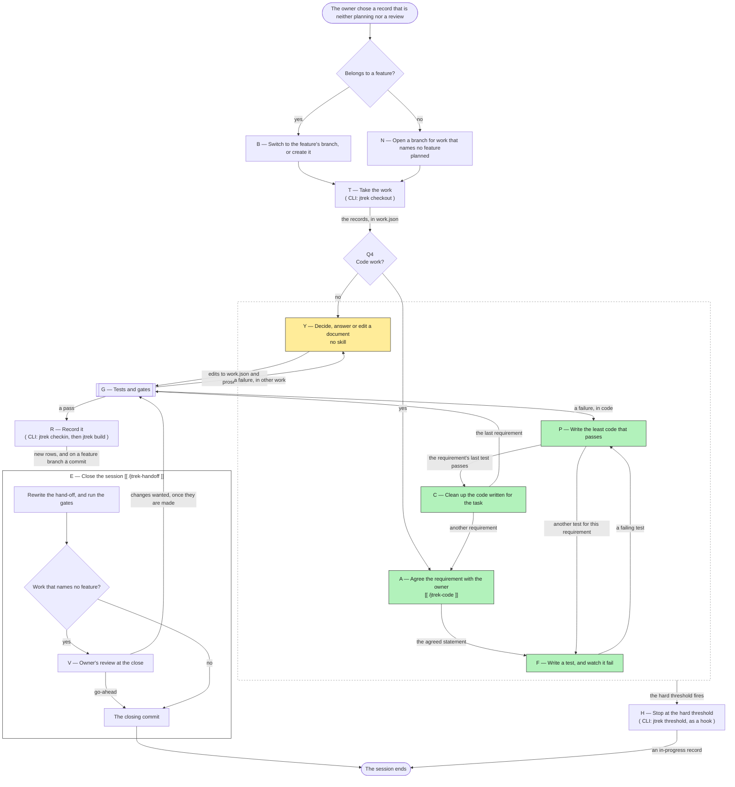

# Work map — code and other work, in one session

> {{SHARED:generated-banner}}

This document draws the work of one session that took a record which is neither planning nor a review. It covers code, which is green in [`{{MAP_OVERALL_DOC}}`]({{MAP_OVERALL_DOC}}), and other work such as a decision, an answer to a question or a change to a document, which is yellow there. The map begins once the owner has chosen the record, and it ends when the session ends. It is written for people. An agent follows the procedure that each card names, and does not act on the map's summary of it. Terms such as **feature**, **feature branch** and **requirement** are defined in [`{{GLOSSARY_DOC}}`]({{GLOSSARY_DOC}}).

The map has three parts. The flowchart shows the nodes and what passes between them. Below it, a card for each node says what starts the node, what it may change, what it does, what it reads and what it produces. The table at the end says which principles each node applies or checks.

**Keep the three parts in step.** No command compares them. When a node is added, removed or renamed, change the flowchart, its card and its column of the table in the same commit, and change the procedure the card names. When the overall map changes a node that this map draws, change this map too. When a document a node reads is renamed or replaced, search this file for its path.

---

## The flowchart

Every node named with a letter has a card below. A rectangle with double sides is a run of the tests and the gates, and a plain rectangle is any other node. A diamond is a question, and a rounded box is where the map begins or ends. The label on an arrow is what passes along it. The colours are those of the overall map: green is code, and yellow is other work.

The second line of a node, where there is one, says how the node is started. `[[ /name ]]` names the skill whose procedure the node follows, and `( CLI: command )` names the jtrek command that the node runs. A command marked as a hook is run by the agent's harness rather than by the session. Skills and hooks exist only in Claude Code, so in another agent a skill's name stands for the procedure document that the node's card names, and the node a hook starts is started by the session watching its own size. A node marked **planned** describes a step that is not in force yet, and its card says what is done today instead.

The dashed box holds the nodes in which the work itself is done, and the hard threshold can fire in any of them. The box with a title holds the steps of closing the session, which all follow one procedure.

---

## The questions

- **Belongs to a feature?** The session answers it from the record. A task belongs to the feature of the requirements it names under `implements` in its `related`, because only a requirement carries a `feature` value. A bug or a change in the code that an open feature branch added belongs to that feature, even though it implements no requirement. A task whose requirements name two features is split before work begins, one task per feature. The section "Branches" in [`{{RULES_DOC}}`]({{RULES_DOC}}) gives these rules.
- **Q4 — Code work?** This is the question Q4 of the overall map. Code work implements a feature, fixes a bug or changes what the product does, and it follows [`{{CODING_DOC}}`]({{CODING_DOC}}). Any other work follows the rules alone.
- **Work that names no feature?** The session answers it from what it did. A feature's work is reviewed when the feature is finished, so only work that names no feature is put before the owner at the close. While a feature branch is open, the only such work is the rows that record findings about other work.

---

## The nodes

### B — Switch to the feature's branch, or create it

- **Started by:** The session starts this node once the owner has chosen a record that belongs to a feature, and before it takes the work.
- **May change:** It switches the working tree to the branch `feature/<slug>`, or creates that branch from the main branch.
- **Does:** It switches to the feature's branch. When the record is the feature's first task, it creates the branch from the main branch first. A later task of the same feature switches to the branch that already exists. The switch comes before the checkout, because the checkout reads the record and the next free id from the registry on the current branch, and only the feature's branch holds the rows written there.
- **Reads:** It reads the record's `related` and the requirements it implements, and the list of branches.
- **Produces:** It produces a working tree on the feature's branch.

### N — Open a branch for work that names no feature (planned)

- **Started by:** The session would start this node once the owner has chosen a record that names no feature.
- **May change:** It would create a branch of its own for the work, from the main branch.
- **Does:** `R-000460` proposes that work which names no feature is done on a branch of its own, because a project's main branch is often protected. Until `R-000460` is settled, the rule in force is different. Work that names no feature is done on the main branch, and only while no feature branch is open. While one is open, such work waits until the branch has merged, and only a row recording a finding about it is written on the feature branch.
- **Reads:** It reads the list of branches.
- **Produces:** Today, it produces a working tree on the main branch.

### T — Take the work

- **Started by:** The session starts this node once it is on the right branch, and never before the owner has chosen, as Step 5 of [`{{OPENING_DOC}}`]({{OPENING_DOC}}) says.
- **May change:** It writes `{{STORE}}/work.json`.
- **Does:** It runs `jtrek checkout --id`, or `jtrek checkout --new` for an item the store has never held. The checkout copies the record's current row into `work.json` and states the next free id. It refuses while `work.json` holds a checkout that was never checked in, because that file then holds edits that exist nowhere else.
- **Reads:** It reads the store on the current branch.
- **Produces:** It produces an open checkout in `work.json`.

### Y — Decide, answer or edit a document

- **Started by:** The session starts this node when the work is not code.
- **May change:** It changes documents in the working tree, `work.json` and the records' prose files.
- **Does:** It does the work the record describes, such as recording a decision, recording the owner's answer to a question, or changing a document. It writes the prose file of every record it changes, beginning with what the problem is. Anything it finds along the way gets a row of its own, appended to `work.json`, as rule R4 in [`{{RULES_DOC}}`]({{RULES_DOC}}) requires.
- **Reads:** It reads [`{{RULES_DOC}}`]({{RULES_DOC}}), the records in `work.json` and their prose files, and the documents the work concerns. It reads the store with `jtrek query`.
- **Produces:** It produces edits to `work.json`, prose files and the changed documents.

### A — Agree the requirement with the owner

- **Started by:** The session starts this node when the work is code, and again for each requirement the task implements. In Claude Code it does so by running `/jtrek-code`, and [`{{CODING_DOC}}`]({{CODING_DOC}}) is its procedure.
- **May change:** It writes requirement records into `work.json`, and their prose files.
- **Does:** It reads the task and every requirement of its feature, and sorts the work into one of four cases, as Step 1 of the procedure says. Work that changes no behaviour a user could observe needs no requirement. For behaviour that no requirement states, it writes the requirement at `open` and shows the owner its statement. A statement states one behaviour, can be observed from outside the code, states behaviour rather than implementation, and covers its important cases. Once the owner agrees, the requirement goes to `planned`. Changing or dropping a requirement in force needs the owner's agreement too. It does not read the coding standards.
- **Reads:** It reads the task's record and prose file, the feature in [`{{SPEC_DOC}}`]({{SPEC_DOC}}), the feature's requirements, [`{{SCHEMA_DOC}}`]({{SCHEMA_DOC}}) and [`{{CODING_DOC}}`]({{CODING_DOC}}). It never reads `{{STORE}}/coding-standards.md`.
- **Produces:** It produces a requirement the owner has agreed to, at `planned`.

### F — Write a test, and watch it fail

- **Started by:** The session starts this node once the requirement is agreed, and again for each test the requirement needs.
- **May change:** It writes test files.
- **Does:** It writes one test case for one scenario of the requirement, and begins the case's name with the requirement's id. Before writing the body, it names the change to the code that would make the test fail. It derives the expected values by hand, and it tests at the product's boundary rather than reading source files or asserting on mocks. It runs the test and watches it fail because the behaviour is missing. A test that passes at once tests behaviour that already exists, which [`{{CODING_DOC}}`]({{CODING_DOC}}) handles by breaking the code on purpose. When a test shows that a requirement cannot hold as written, the session stops writing code and revises the requirement with the owner, as Step 5 of the procedure says.
- **Reads:** It reads the requirement and the code the test exercises.
- **Produces:** It produces a test that names the requirement and fails.

### P — Write the least code that passes

- **Started by:** The session starts this node when the test fails, or when node G finds a failure in code.
- **May change:** It changes the source files.
- **Does:** It writes the least code that makes the test pass, and adds no option, parameter or behaviour that no test asks for. It runs the whole suite rather than only the new test, and it reports every failure by name. If the test still fails, it fixes the code rather than the test, unless the test is itself wrong.
- **Reads:** It reads the failing test and the code it exercises.
- **Produces:** It produces code that passes the test.

### C — Clean up the code written for the task

- **Started by:** The session starts this node after the last passing test of each requirement. It may also start it after any cycle whose test passes.
- **May change:** It changes only the code and the tests written during this task.
- **Does:** It restructures the code it has written, such as removing what an earlier cycle repeated or renaming what was named before the shape of the code was clear. It leaves code that existed before the task as it is. It adds no behaviour, removes no assertion and changes no expected value in a test, and the whole suite must pass afterwards. It does not read the coding standards, because the refactoring review brings the code up to them once the feature is finished. "Cleaning up the code written for the task" in [`{{CODING_DOC}}`]({{CODING_DOC}}) is its procedure.
- **Reads:** It reads the code and the tests written during the task.
- **Produces:** It produces cleaner code, with the whole suite passing.

### G — Tests and gates

- **Started by:** The session starts this node before each check-in, as Step 7 of [`{{CODING_DOC}}`]({{CODING_DOC}}) says for code. Other work is checked by the gates before its check-in in the same way.
- **May change:** It changes nothing.
- **Does:** For code, it runs the whole test suite afresh and counts its failures, finds the test that names each requirement the task implements, and makes the mutation check: for each realistic mistake in the new code, at least one test must fail. For all work, it runs the three gates that [`{{RULES_DOC}}`]({{RULES_DOC}}) lists, which are `jtrek check`, `jtrek build --check` and `jtrek agent --check`. A failure sends the work back to node P or node Y.
- **Reads:** It reads the code, the tests and the store.
- **Produces:** It produces a pass, or a list of the failures.

### R — Record it

- **Started by:** The session starts this node once the work is finished, its prose file included, and the tests and the gates pass. Rule R2 in [`{{RULES_DOC}}`]({{RULES_DOC}}) is the reason it waits until then.
- **May change:** It appends rows to `{{STORE}}/registry.ndjson`, regenerates `{{STORE}}/registry.md`, and on a feature branch commits.
- **Does:** It runs `jtrek checkin`, which appends a new revision of each changed record and stamps `work.json` as checked in, and then `jtrek build`. A requirement goes to `done`, which means in force, in the check-in that lands its passing test. In that revision, `files` names the test file, the `note` says which test verifies it, and the task names the requirement under `implements`, as Step 6 of [`{{CODING_DOC}}`]({{CODING_DOC}}) says. On a feature branch, it commits the record with its code, its tests, its rows, its prose file and the regenerated `registry.md`, in a commit whose message names the record.
- **Reads:** It reads `work.json`.
- **Produces:** It produces new rows in the store, and on a feature branch one commit per record.

### E — Close the session

- **Started by:** The session starts this node when its work ends. In Claude Code it does so by running `/jtrek-handoff`, and [`{{HANDOFF_DOC}}`]({{HANDOFF_DOC}}) is its procedure.
- **May change:** It rewrites [`{{HANDOFF_FILE}}`]({{HANDOFF_FILE}}), writes any record the session's work still lacks, and commits.
- **Does:** It first writes into the store anything the session finished, decided, abandoned or worked around that the store does not yet hold, and lists the session's work with the row that holds each item. It runs `jtrek handoff` and takes every figure in the hand-off from it. It rewrites only the sections of the hand-off that changed, and deletes what no longer describes where things stand. It runs the gates, puts any work that names no feature before the owner in node V, and then makes the closing commit if every gate passed and the owner did not decline. It never pushes without a go-ahead.
- **Reads:** It reads the store, the hand-off and the work of the session.
- **Produces:** It produces the rewritten hand-off and the closing commit.

### V — Owner's review at the close

- **Started by:** The closing session starts this node in Step 6 of [`{{HANDOFF_DOC}}`]({{HANDOFF_DOC}}), after the gates pass, when the session did work that names no feature.
- **May change:** The session makes the changes the owner asks for, and runs the gates again.
- **Does:** The session gives the owner a short report on the work that names no feature. It opens with the merge danger, as the section "The merge danger" of [`{{REVIEWING_DOC}}`]({{REVIEWING_DOC}}) describes it, and then summarises what changed. The owner then approves the work or asks for changes.
- **Reads:** The session reads the work it did, the list of one-way doors in the section "The merge danger", and the project's own one-way doors in [`{{ARCHITECTURE_DOC}}`]({{ARCHITECTURE_DOC}}).
- **Produces:** It produces the owner's go-ahead for the closing commit, or a list of changes.

### H — Stop at the hard threshold

- **Started by:** In Claude Code, the hook `jtrek threshold` starts this node by telling the session that it has crossed the hard threshold, which the project sets in `jtrek.json`. It can fire in any node of the dashed box. [`{{SESSION_DOC}}`]({{SESSION_DOC}}) is its procedure.
- **May change:** It appends to the record's prose file, checks the record in, rewrites two sections of the hand-off, and commits if the owner agreed.
- **Does:** It appends what is done to the prose file, and checks the record in at `in-progress` with a `note` saying where it stopped and what comes next. It rewrites the hand-off's "Start here" and "Where things stand", runs `jtrek build`, `jtrek handoff` and the gates, commits if the owner agreed and every gate passed, and stops. It never pushes. The next session reports the record as a blocker, to be resumed first.
- **Reads:** It reads the record's prose file and the hand-off.
- **Produces:** It produces an `in-progress` record and a rewritten hand-off.

---

## Principles and the nodes that hold them

A cell says **applies** when the node follows the principle in its own work, and **checks** when the node looks for a breach of it in work done by another node. An empty cell means the node has no part in that principle. Nodes B and N share a column because both choose the branch the work is done on.

| Principle | Written in | B, N | T | Y | A | F | P | C | G | R | E | V | H |
| --------- | ---------- | ---- | - | - | - | - | - | - | - | - | - | - | - |
| A feature's work is done on its own branch, and one branch at a time writes records. | The section "Branches" in [`{{RULES_DOC}}`]({{RULES_DOC}}) | applies | | | | | | | | | | | |
| While a feature branch is open, a session works only on that feature. | The section "Branches" in [`{{RULES_DOC}}`]({{RULES_DOC}}) | applies | | | | | | | | | | | |
| Nothing is taken until the owner has chosen. | Step 5 of [`{{OPENING_DOC}}`]({{OPENING_DOC}}) | | applies | | | | | | | | | | |
| One checkout is open at a time. | The section "Checking out" in [`{{RULES_DOC}}`]({{RULES_DOC}}) | | applies | | | | | | | | | | |
| The store is read with `jtrek query`, and never with `grep`. | Rule R3 in [`{{RULES_DOC}}`]({{RULES_DOC}}) | | | applies | applies | | | | | | applies | | |
| What a session finds gets a row of its own. | Rule R4 in [`{{RULES_DOC}}`]({{RULES_DOC}}) | | | applies | applies | applies | applies | applies | | | applies | | |
| The owner agrees to a requirement before any code is written for it. | Step 2 of [`{{CODING_DOC}}`]({{CODING_DOC}}) | | | | applies | | | | | | | | |
| A test is seen failing before the code that makes it pass is written. | Step 3 of [`{{CODING_DOC}}`]({{CODING_DOC}}) | | | | | applies | | | | | | | |
| A test must be able to fail. | Steps 3 and 7 of [`{{CODING_DOC}}`]({{CODING_DOC}}) | | | | | applies | | | checks | | | | |
| The writer writes the least code that passes the test, and fixes the code rather than the test. | Step 4 of [`{{CODING_DOC}}`]({{CODING_DOC}}) | | | | | | applies | | | | | | |
| The writer cleans up only the code and tests it wrote during the task, adds no behaviour, and changes no expected value in a test. | Step 4 of [`{{CODING_DOC}}`]({{CODING_DOC}}) | | | | | | | applies | | | | | |
| The writer does not read the coding standards. | [`{{RULES_DOC}}`]({{RULES_DOC}}) and Step 4 of [`{{CODING_DOC}}`]({{CODING_DOC}}) | | | | applies | applies | applies | applies | | | | | |
| Nothing is claimed that a command run in this session has not shown. | Step 7 of [`{{CODING_DOC}}`]({{CODING_DOC}}) | | | | | | | | applies | | | | |
| A requirement in force names a test file that names the requirement. | Step 6 of [`{{CODING_DOC}}`]({{CODING_DOC}}) | | | | | | | | checks | applies | | | |
| The store's history is only ever appended to. | Rule R1 in [`{{RULES_DOC}}`]({{RULES_DOC}}) | | | | | | | | checks | applies | | | |
| A record is checked in only once its work is finished, prose file included. | Rule R2 in [`{{RULES_DOC}}`]({{RULES_DOC}}) | | | | | | | | | applies | | | |
| On a feature branch, each record is committed once its tests and the gates pass. | The section "Branches" in [`{{RULES_DOC}}`]({{RULES_DOC}}) | | | | | | | | | applies | | | |
| Every figure in the hand-off comes from `jtrek handoff`. | Step 2 of [`{{HANDOFF_DOC}}`]({{HANDOFF_DOC}}) | | | | | | | | | | applies | | |
| Work that names no feature is put before the owner, merge danger first. | Step 6 of [`{{HANDOFF_DOC}}`]({{HANDOFF_DOC}}), and the section "The merge danger" in [`{{REVIEWING_DOC}}`]({{REVIEWING_DOC}}) | | | | | | | | | | | applies | |
| Nothing is pushed without the owner's go-ahead. | Step 6 of [`{{HANDOFF_DOC}}`]({{HANDOFF_DOC}}), and [`{{SESSION_DOC}}`]({{SESSION_DOC}}) | | | | | | | | | | applies | | applies |
| `in-progress` means only that a session ended with the record unfinished. | [`{{SESSION_DOC}}`]({{SESSION_DOC}}) | | | | | | | | | | | | applies |
